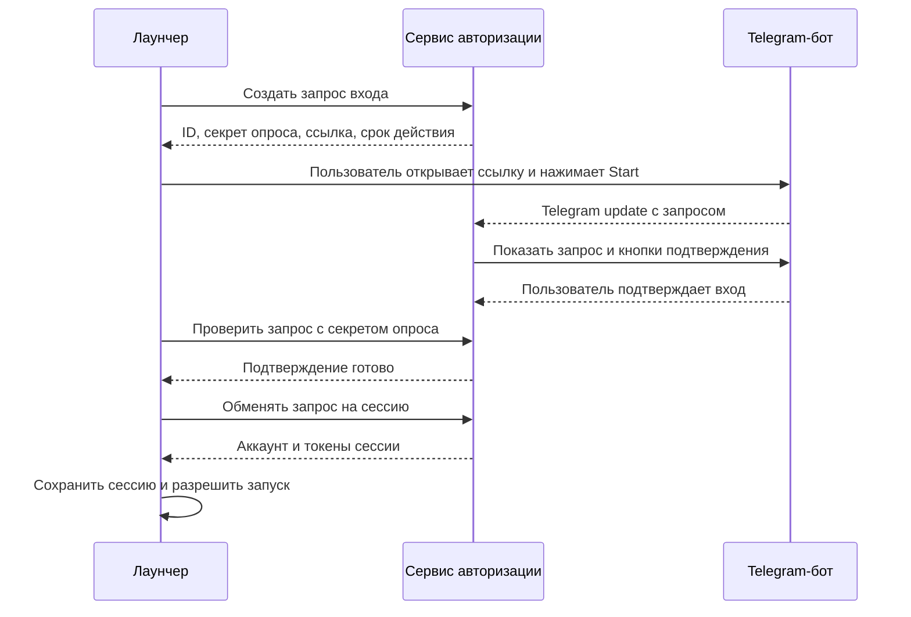

# План разработки: настройки ОЗУ и вход через Telegram

Дата: 14 октября 2026 года.

Обновление 15 октября 2026: Telegram-вход реализован через существующий Express backend, users.json и отдельный Node.js worker. Актуальное поведение описано в [TELEGRAM_AUTH.md](TELEGRAM_AUTH.md). Предложения ниже про отдельный Rust-сервер, SQLite и refresh-токены не реализованы. Живая production-проверка требует настроенного бота и HTTPS backend.

Исторический статус на 14 октября: этапы 1–3 (настройки ОЗУ) реализованы и проверены локальными тестами. Числовые ограничения и сроки жизни Telegram ниже — исходные предложения.

### Реализовано 14 октября 2026 года

- Общий объект настроек сохраняет ник и необязательное `memory_mib`; старый JSON читается без миграционного скрипта. Запись атомарная; ошибка сохранения ОЗУ оставляет экран открытым.
- Windows `GlobalMemoryStatusEx` определяет физическую и текущую свободную память. Диапазон использует минимум 1024 МБ, резерв `max(2048, ceil(total / 5))` и шаг 256 МБ. Ошибка определения и слишком малый объём блокируют запуск; сведения можно обновить в настройках.
- `UserLaunchOptions` передаются через `watch` и фиксируются при обработке `Play`. Общий `HeapMemory` проверяет исходный backend-диапазон и рассчитывает эффективные `Xms/Xmx` для обоих loader. Vanilla заменяет heap-аргументы и сохраняет остальные; проверки конфликтов NeoForge сохранены.
- Slint-экран использует палитру существующего лаунчера: тёмная панель, бронзовая рамка, зелёный ползунок, ввод МБ и отображение ГБ. Поддержаны точный ввод целых чисел, стрелки, «Назад», «Сохранить», повторное определение памяти и явное исправление слишком большого сохранённого значения. Папка игры отображается без изменения пути.
- Тесты проверяют сохранение после перезапуска, ошибки записи/определения памяти, ограничения 4/8/16/32 ГБ, реальный ввод с клавиатуры, параметры синтетического процесса Vanilla и снимок ОЗУ при повторных backend-запусках NeoForge. Программные рендеры экрана проверены при масштабах 100/125/150%. Настоящий Minecraft и production-сервисы для этих проверок не запускались.

Для повторной визуальной проверки можно сохранить PNG в генерируемый каталог:

```powershell
$env:LAUNCHER_UI_PREVIEW_DIR = Join-Path (Get-Location) 'target/ui-preview'
cargo test -p launcher-desktop memory_screen_syncs_validates_saves_and_renders
Remove-Item Env:LAUNCHER_UI_PREVIEW_DIR
```

Следующий этап: отдельный пакет `apps/telegram-auth`, SQLite и API запросов/сессий. Токен бота для разработки и локальных fixtures не требуется.

Дополнительно исправлено открытие настроек первым кликом: клавиатурный слой кнопок расположен под TouchArea и получает фокус без поглощения нажатия. При запуске и работе игры блокируются игровые действия и ник. Добавлены конкретные этапы запуска и панель диагностики с причиной, кодом завершения, stdout/stderr и асинхронным чтением launcher.log. После ошибки ядро допускает повторный Play; новая попытка не получает запоздалые результаты чтения старого лога.

Обновление модов теперь передаёт подробные фазы и метрики: ожидание ответа, скачивание `mods.zip` (байты, скорость, время, пауза), проверка архива, распаковка конкретного JAR/файла, счётчик подготовленных файлов и фиксация установки. Имена отдельных модов не подставляются во время скачивания общего ZIP. Передача без `Content-Length` проверена локальным chunked HTTP fixture. UI получает последний снимок без очереди устаревшего прогресса; после изменений выполняется `cargo build --release`.

Дополнительно выровнены карточки версии/сервера, отступы иконок, строки текста, кнопки и верхняя панель. Фиксированные «онлайн» и 43 мс заменены реальным Minecraft Java status/ping/pong: проверка при открытии, затем каждые 15 секунд, таймаут 5 секунд. Добавлены жёлтая иконка с двумя полосками (101–250 мс), красная с одной (>250 мс) и серая перечёркнутая без полосок (нет подтверждённого ответа). Зелёная иконка с тремя полосками используется до 100 мс. При ошибке пинг очищается, смена адреса отменяет предыдущую проверку; запуск игры не блокируется из-за отключённого status. Сетевые сценарии проверяются локальными TCP fixtures; UI-превью включают все состояния и длинный адрес при масштабах 100/125/150%.

## 1. Результат

- Экран «Настройки» в стиле присланного макета: тёмная панель, бронзовая рамка, зелёный ползунок, поле числа, подписи МБ/ГБ, «Назад» и «Сохранить».
- Выбранная ОЗУ сохраняется между запусками и действительно применяется к Minecraft Vanilla и NeoForge.
- Кнопка «Войти через Telegram» открывает бота. Пользователь подтверждает запрос; лаунчер получает аккаунт и сохраняет сессию.
- При следующем открытии лаунчера сессия восстанавливается; доступен выход из аккаунта.
- Для владельца бота в серверном `.env` предусмотрено ровно имя `telegrambotapi`. Отдельно вводить имя бота не требуется.

Блок выбора папки установки на макете не входит в эти две функции. Его можно добавить отдельной задачей: текущие пути вычисляются при старте, поэтому рабочий выбор папки требует самостоятельной доработки хранения и установки. В первом экране можно показать текущий путь без кнопки изменения.

## 2. Исходное состояние перед началом реализации

| Файл | Текущее поведение | Изменение |
| --- | --- | --- |
| `apps/desktop/src/settings.rs` | `Settings` содержит только `username`; `save_profile` записывает весь файл заново | Общие настройки, миграция старого JSON, сохранение всех полей |
| `apps/desktop/src/main.rs` | `settings-requested` пишет debug-лог; `Play` использует offline-профиль | Навигация, привязки ОЗУ, вход/выход и отображение аккаунта |
| `apps/desktop/ui/main.slint` | Главное окно 1180×750, экран настроек отсутствует | Переключение главного экрана и настроек, отображение входа |
| `crates/launcher-core/src/lib.rs` | Команды `Play`/`Cancel`, состояние и offline-профиль через каналы | Передача пользовательских параметров запуска и проверка сессии |
| `crates/launcher-core/src/game_actor.rs` | Повторно применяет backend-конфигурацию на каждом запуске | Объединение backend-параметров с сохранённым выбором пользователя |
| `crates/launcher-core/src/minecraft/launcher.rs` | В `VanillaLaunchConfig` нет параметров памяти | Общие параметры heap для Vanilla |
| `crates/launcher-core/src/minecraft/neoforge/launch.rs` | `-Xms`/`-Xmx` берутся из backend; есть проверка конфликтующих JVM-аргументов | Применение пользовательского максимума с сохранением проверок |
| `crates/launcher-core/src/auth/` | Microsoft/Xbox/Minecraft-авторизация библиотеки | Отдельный модуль Telegram-сессии, без смешивания двух видов входа |

Telegram-кода и backend-исходников в репозитории сейчас нет. Существующий production backend использует HTTP; выдача и передача сессионных секретов в production потребуют HTTPS.

## 3. Настройки ОЗУ

### Поведение экрана

1. При открытии показывать сохранённое значение. Если пользователь ещё не задавал память — валидное `maxMemory` backend, ограниченное возможностями компьютера.
2. Ползунок и поле ввода управляют одним числовым значением. Движение ползунка сразу обновляет число и подпись в ГБ; корректный ввод числа обновляет положение ползунка.
3. Шаг ползунка и стрелок — 256 МБ. Поле позволяет вводить любое целое число в разрешённом диапазоне; принудительного округления введённого числа нет.
4. Пустое поле во время редактирования допустимо. Пустое, отрицательное, дробное, нечисловое или слишком большое значение блокирует «Сохранить» и показывает понятную ошибку.
5. «Сохранить» атомарно записывает настройки, обновляет параметры ядра и возвращает на главный экран. При ошибке записи экран остаётся открытым с сообщением.
6. «Назад» отменяет несохранённые изменения. Изменение ОЗУ применяется со следующего игрового запуска; уже работающий процесс не перезапускается.
7. Рекомендация 4096–8192 МБ из макета адаптируется к компьютеру. Не показывать недостижимую рекомендацию на машине с малым объёмом ОЗУ.

### Объём и ограничения

- Внутри кода хранить MiB (`memory_mib`); в UI использовать привычное «МБ», 1 ГБ = 1024 МБ.
- Сведения о физической памяти получать в Desktop через Windows API `GlobalMemoryStatusEx`; обёртку вынести в `apps/desktop/src/system_memory.rs`. API возвращает сведения о физической памяти и её текущей доступности: [Microsoft](https://learn.microsoft.com/en-us/windows/win32/api/sysinfoapi/nf-sysinfoapi-globalmemorystatusex).
- Предлагаемый минимум — 1024 МБ. Резерв для ОС и приложений — большее из 2048 МБ и 20% физической памяти. Максимум ползунка — физическая память минус резерв, округлённый вниз до 256 МБ.
- Разделять «Всего ОЗУ», «Свободно сейчас» и «Можно выделить». Максимум не должен прыгать из-за текущей загрузки системы. Выбранное значение задаёт предел Java heap, а не полное потребление Minecraft.
- Если безопасный максимум ниже минимума, сообщать о недостатке памяти и блокировать запуск. Если Windows API недоступен — сообщать об ошибке определения памяти, не подставлять вымышленный объём и не запускать до успешного повторного определения.
- Если сохранённое значение стало выше максимума после изменения компьютера, показывать исходное и предложенное допустимое значение; требовать сохранения исправления перед запуском.

### Хранение и передача в ядро

Предлагаемый формат `state/settings.json`:

```json
{
  "username": "HorseLover",
  "memory_mib": 6144
}
```

- `memory_mib` — необязательное поле с `serde(default)`: старый файл `{ "username": "Player" }` продолжает читаться.
- Обновить `SettingsStore` и `ProfileController`: изменение ника сохраняет ОЗУ, изменение ОЗУ сохраняет ник. Использовать единый актуальный объект настроек, исключить перезапись полей устаревшими копиями.
- В `launcher-core` ввести `UserLaunchOptions { max_memory_mib: Option<u32> }` и канал обновлений с методом `set_launch_options`. Объём компьютера определяет Desktop, проверку числовых параметров и применение JVM выполняет ядро.
- При обработке `Play` ядро фиксирует снимок настроек; дальнейшие изменения относятся к следующему запуску. Проверка пригодности выбранного значения выполняется также перед отправкой `Play`.
- Приоритет максимума: сохранённый пользовательский выбор, затем валидное значение backend. Повторное получение client config не затирает пользовательский выбор.
- Исходные backend-параметры сначала проверяются на корректность. Эффективный `Xmx` равен выбранному максимуму; `Xms` равен меньшему из валидного backend `minMemory` и эффективного `Xmx`.
- Для обоих loader формировать одну итоговую пару `-Xms…M`/`-Xmx…M`. Для Vanilla заменить штатные heap-аргументы метаданных выбранными значениями; для NeoForge сохранить существующий отказ при конфликтующих heap-аргументах backend/distribution. Остальные JVM-аргументы сохранить.

## 4. Telegram-бот и сервер авторизации

### Размещение

Добавить самостоятельный Rust-пакет `apps/telegram-auth` в workspace: HTTP API, обработчик бота и постоянная SQLite-база. Предлагаемые инструменты: Tokio/Reqwest, Axum, SQLite-драйвер и загрузчик `.env`; версии выбрать при реализации и зафиксировать в `Cargo.lock`.

Лаунчер обращается к HTTP API сервиса. Только сервер обращается к Telegram Bot API и читает токен бота. Такое размещение исключает необходимость раздавать всем игрокам секрет управления ботом.

Локальные значения по умолчанию: адрес `127.0.0.1:3001`, база `.auth-data/auth.sqlite`. В production сервис запускается постоянно; reverse proxy направляет `/api/auth/*` к нему, а `/api/client-config` — к существующему backend. Адрес API лаунчер получает через имеющийся `LAUNCHER_SERVER_URL`; production origin должен использовать HTTPS. HTTP разрешить для локальной разработки на loopback.

### Конфигурация `.env`

При реализации создать корневые `.env` и `.env.example` с пустым полем:

```dotenv
telegrambotapi=
```

- Имя именно `telegrambotapi`, в нижнем регистре. Вставляется полный токен от BotFather; без префикса `bot` и без URL.
- Переменная процесса имеет приоритет над `.env`. Сервис загружает явно определённый `.env` из рабочего каталога, а не ищет произвольные родительские файлы.
- При пустом токене сервер завершает запуск с понятной ошибкой. При неверном токене сообщает об ошибке проверки, не выводя его значение.
- Имя бота получать через `getMe`, отдельный `bot_username` в `.env` не нужен. Метод описан в [Telegram Bot API](https://core.telegram.org/bots/api#getme).
- `.env` и `.auth-data/` добавить в `.gitignore`; `.env.example` сохранить в Git. Токен, базу сервера и серверный `.env` не включать в Windows-дистрибутив.
- Аккаунт бота регистрирует владелец через `/newbot` у BotFather и вставляет полученный токен. Разработка кода сама по себе не создаёт Telegram-аккаунт бота: [официальная инструкция](https://core.telegram.org/bots/tutorial#obtain-your-bot-token).

### Вход пользователя



1. Сервис создаёт случайный идентификатор запроса, одноразовый параметр ссылки и отдельный секрет опроса. Срок запроса — 5 минут. Секрет опроса остаётся только у лаунчера.
2. Лаунчер показывает «Открыть Telegram», «Скопировать ссылку», состояние ожидания и «Отмена». Автоматический опрос — примерно раз в 2 секунды, с увеличением интервала при временной сетевой ошибке.
3. Ссылка имеет вид `https://t.me/<имя_бота>?start=<одноразовый_параметр>`. Параметр должен укладываться в ограничение Telegram — 64 символа и разрешённый алфавит: [Deep Linking](https://core.telegram.org/bots/features#deep-linking).
4. В приватном чате бот показывает название лаунчера, время и короткий код запроса, совпадающий с кодом в окне. Кнопки — «Подтвердить вход» и «Отклонить». Одного открытия ссылки недостаточно.
5. Запрос атомарно связывается с Telegram `user.id`; подтверждать его может только этот пользователь и только в исходном приватном чате. Повторные и просроченные подтверждения не выдают сессию.
6. Сервис сообщает лаунчеру состояние. Выдача токенов идёт отдельным одноразовым обменом с секретом опроса; сам ID запроса и параметр Telegram-ссылки не дают права получить токены. Если ответ обмена потерян, запускается новый вход.
7. При первом входе аккаунт переходит в `ProfileRequired`: пользователь выбирает Minecraft-ник, сервис проверяет формат и уникальность. При повторном входе ник возвращается с сервера.
8. Telegram `user.id` — постоянный ключ аккаунта. Отсутствие или изменение Telegram username не должно ломать вход.

### API и хранение

| Метод и путь | Назначение |
| --- | --- |
| `POST /api/auth/telegram/challenges` | Создать запрос; вернуть ID, ссылку, секрет опроса и `expires_at` |
| `GET /api/auth/telegram/challenges/{id}` | Получить `pending/confirmed/rejected/expired/cancelled/consumed`; секрет передавать в заголовке |
| `DELETE /api/auth/telegram/challenges/{id}` | Отменить запрос с тем же секретом |
| `POST /api/auth/telegram/challenges/{id}/exchange` | Однократно получить сессию после подтверждения |
| `POST /api/auth/session/refresh` | Обновить сессию и заменить refresh-токен |
| `GET /api/auth/me` | Проверить access-токен и получить профиль |
| `PUT /api/auth/profile` | Однократно выбрать ник после первого входа |
| `POST /api/auth/logout` | Отозвать сессию текущего устройства |

Использовать непрозрачные случайные токены не менее 256 бит; в базе хранить их хеши. Access-токен действует 15 минут, refresh-токен — 30 дней с заменой при обновлении. Таблицы: аккаунты, запросы входа, сессии и состояние обработки Telegram updates. Уникальность ников обеспечить в транзакции без учёта регистра; существующие offline-ники нельзя автоматически считать доказательством владения аккаунтом.

Обработчик бота использует long polling `getUpdates`, только сообщения и callback-запросы. Offset сохраняется после обработки; повторная доставка update не должна создавать повторное подтверждение. При активном webhook или втором обработчике сервис сообщает о конфликте; не удаляет чужой webhook автоматически. Long polling и webhook взаимно исключаются: [Telegram Bot API](https://core.telegram.org/bots/api#getupdates).

Добавить ограничения частоты запросов и числа активных запросов, очистку просроченных данных, таймауты и повторные попытки при временной недоступности Telegram. Не логировать токен бота, полные Bot API URL с токеном, секреты ссылок, Authorization, тела обмена/обновления и токены сессии.

## 5. Интеграция в лаунчер

- В ядре добавить `auth/telegram/`: клиент API и `TelegramAuthState` через `watch` для ожидания, подтверждения, наличия сессии и ошибок. UI, открытие ссылки и локальное хранилище оставить в Desktop.
- Сессионные токены сохранять атомарно в отдельном `state/telegram-session.dat`, защищённом Windows DPAPI в контексте текущего пользователя, без флага общего доступа компьютера. Не хранить токены в обычном `settings.json`. Возможности API описаны у [Microsoft](https://learn.microsoft.com/en-us/windows/win32/api/dpapi/nf-dpapi-cryptprotectdata).
- При старте асинхронно восстановить и проверить сессию; при необходимости обновить. Ошибка расшифровки, отзыв или истечение refresh-токена возвращают экран входа. При потере сети показывать ошибку и возможность повторить, не выдавать ложное состояние входа.
- В заголовке показывать серверный Minecraft-ник. В настройках добавить аккаунт и кнопку «Выйти». После привязки свободное редактирование ника отключить; смену ника и восстановление владения рассматривать отдельно.
- Разрешение «Играть» зависит от наличия проверенной сессии, валидного профиля, ОЗУ и состояния запуска. Проверять авторизацию также внутри обработки `Play` до загрузок и непосредственно перед запуском процесса; одной блокировки кнопки недостаточно.
- Профиль для игры получать из ответа сервиса и преобразовывать в существующий `OfflineProfile`/`MinecraftLaunchIdentity`. Telegram-токен не подставлять в Minecraft access token.
- Отмену входа обрабатывать независимо от отмены игрового запуска. При закрытии окна прекратить опрос; поздний ответ отменённой попытки не должен менять текущий аккаунт.
- При выходе отзывать серверную сессию и удалять локальную копию. При недоступности сервера локальный выход всё равно выполняется, UI сообщает, что серверный отзыв не подтверждён. Уже запущенную игру автоматически не завершать.

Это авторизация аккаунта лаунчера. Она не заменяет Microsoft/Minecraft-аутентификацию и сама по себе не защищает offline Minecraft-сервер от прямого подключения другим клиентом. Для такого контроля нужна отдельная интеграция с игровым сервером; её протокол и реализация зависят от отсутствующих в этом репозитории серверных исходников.

## 6. Порядок разработки

| Этап | Работа | Критерий завершения |
| --- | --- | --- |
| 1 | Модель настроек, миграция JSON, получение объёма ОЗУ | Старый ник сохраняется; валидаторы и диапазон памяти работают |
| 2 | Передача ОЗУ в ядро и общий расчёт heap | Vanilla и NeoForge получают выбранный `Xmx`, без дубликатов |
| 3 | Slint-экран по макету, ползунок, число, сохранение | Оба способа ввода синхронизированы; сохранение переживает перезапуск |
| 4 | Пакет сервера, SQLite, `.env`, API запросов и сессий | Локально работает жизненный цикл запроса и отзыв сессии |
| 5 | Бот, ссылка входа и кнопки подтверждения | Только корректное подтверждение соответствующего пользователя разрешает обмен |
| 6 | Telegram-клиент ядра, экран входа, DPAPI и блокировка `Play` | Вход, перезапуск, обновление сессии и выход работают вместе |
| 7 | Документация, упаковка и проверка production-связки | Лаунчер обращается к HTTPS API; в дистрибутиве нет серверных секретов |

Этапы 1–3 дают самостоятельную готовую функцию ОЗУ. Для этапов 4–6 можно полностью разработать код и проверить его с локальными fixtures без реального токена. Живая проверка этапов 5–7 требует зарегистрированного бота, введённого владельцем токена и размещённого сервиса.

## 7. Проверки и критерии приёмки

| Область | Проверки |
| --- | --- |
| Настройки | Старый JSON; сохранение ника не удаляет ОЗУ; сохранение ОЗУ не удаляет ник; ошибка записи не показывает успех |
| Память | 4/8/16/32 ГБ физической памяти; слишком малый объём; недоступный Windows API; пустые/отрицательные/дробные значения; переполнение; значение выше максимума |
| JVM | Для двух loader выбранное значение присутствует ровно один раз; `Xms ≤ Xmx`; новая client config не затирает выбор; существующие проверки конфликтов NeoForge сохраняются |
| Telegram/API | Подтверждение, отказ, отмена, истечение; чужой callback; повторный update; повторный обмен; конкурентные подтверждения; неверный секрет опроса; конфликт webhook |
| Сессия | Перезапуск сервиса и лаунчера; обновление и отзыв; просроченный токен; повреждённое DPAPI-хранилище; ошибка сети; потерянный ответ обмена/обновления |
| Доступ | `Play` без авторизации; отзыв перед запуском; поздний ответ отменённой попытки; уникальность ников и отсутствие автоприсвоения старого offline-ника |
| UI | Вид в окне 1180×750 и при масштабировании Windows 100/125/150%; клавиатура, фокус, ввод/вставка числа; переходы «Назад»/«Сохранить» |
| Поставка | EXE/README не содержат `.env`, SQLite и токен бота; серверная инструкция описывает отдельный постоянный запуск и HTTPS |

Сетевые тесты выполнять через локальный HTTP-сервер и fixtures, без обращения к production backend. Игровые пробные запуски — с `LAUNCHER_DATA_DIR` во временном каталоге. После реализации выполнить:

```powershell
cargo fmt --all -- --check
cargo check --workspace --all-targets
cargo clippy --workspace --all-targets --all-features -- -D warnings
cargo test --workspace
```

Обновить `AGENTS.md`, `packaging/README.txt`, инструкции серверного запуска и при необходимости `scripts/package-release.ps1`. Упаковка Desktop остаётся отдельной от поставки сервера авторизации.

Готовность подтверждается сквозным сценарием: пользователь сохраняет 6144 МБ → входит через подтверждение в боте → запускает Minecraft с `-Xmx6144M` → перезапускает лаунчер без повторного входа → выходит и больше не может запустить игру до новой авторизации.
